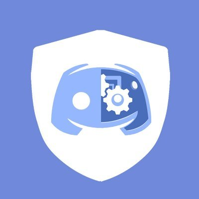

<div align="center">



# AQUA MoD

**A multi-purpose Discord moderation bot - built and maintained 2020 → 2021**

[](https://aoi.js.org)
[](https://discord.js.org)
[](https://nodejs.org)

[](#-why-its-archived)

[What it is](#-what-it-is) · [Highlights](#-highlights) · [Commands](#-command-reference) · [Archive notes](#-why-its-archived) · [Security](#-security-notes)

</div>

---

> [!WARNING]
> **Archived codebase - it does not run as it stands.** This is a 2021 build published as a reference. Every third-party API it talked to has since shut down, its framework is end-of-life, and the music stack relied on a pre-2022 `ytdl-core`. See [Why it's archived](#-why-its-archived). The engineering is real; the integrations are archaeology.

## 📖 What it is

AQUA MoD is a Discord bot written with **[aoi.js](https://aoi.js.org) v4.5** - the "no-code" framework where a command isn't a function, it's a **template string of `$functions`** that the interpreter evaluates at runtime.

```js
bot.command({
  name: "ping",
  code: `$title[🏓 Pong!] $description[$ping ms] $color[RANDOM]`
})
```

That's the whole idiom. No `async`, no imports per command, no routing - aoi.js parses `$title[...]`, evaluates the nested calls inside-out, and posts the result. The consequence is that **all 3,000 lines are one file**, ordered by feature, with guard functions stacked at the bottom of each command because the interpreter reads bottom-up.

It shipped with moderation, an anti-raid suite, levelling with rendered rank cards, music, a welcomer, invite tracking, snipe, reaction roles and a help menu - all in one `aqua-mod.js`.

## 🧭 At a glance

| | |
| :--- | :--- |
| **Years worked on** | **2020 – 2021** · last commit Nov 3, 2021 |
| **Bot account created** | 20 December 2020 |
| **Framework** | aoi.js v4.5 (discord.js v12) |
| **Size** | 3,102 lines · 131 registered commands · 7 help pages|
| **Storage** | `dbd.db` - per-server, per-user and per-channel variables |
| **Prefix** | `aqa `, per-server, changeable |
| **Status** | Archived, unmaintained |

## ✨ Highlights

The parts of this codebase that were actually interesting to write:

- **🎭 NQN emoji system** - resolves `:emoji_name:` against the bot's emoji cache, deletes the original message, then **re-sends it through a webhook impersonating the author** (name + avatar swapped, then reset). Server emojis used like Nitro ones, without Nitro.
- **🔍 Snipe stack** - last deleted message per channel, plus `snipeall`, which keeps a rolling 10-entry log serialised into a single `§`-delimited channel variable and re-parses it on read. Also `editsnipe` via `onMessageUpdate`.
- **📈 Levelling** - XP on a 7-second per-user cooldown, geometric requirement curve (`req += req × 0.5`), configurable level-up roles, per-level custom messages, and rank cards rendered server-side by an external card API with a user-chosen background.
- **🛡️ Anti-raid** - three independent join handlers (kick / mute / kick-bots), each with its own logging channel, plus an `onMessageUpdate` handler that catches links edited in *after* the fact to dodge anti-link.
- **🔄 Self-updating embeds** - two `loopCommand`s rewrite a voice channel name (live member count, every 2 min) and a status embed (ping, CPU, RAM, presence breakdown, every 2 s).
- **🧙 Profile wizard** - a 6-step `$awaitMessages` conversation collecting name, age, pet, country, hobbies and bio into global user variables.

## 🧩 How a command works

aoi.js evaluates a code block **bottom-up**, so every command is written as *output first, guards last*:

```js
bot.command({
  name: "ban",
  code: `
  $ban[$mentioned[1];$noMentionMessage]      // ← action
  $sendDM[...]                               // ← side effects
  $channelSendMessage[$getServerVar[logchannel];{title:BAN}...]
  $onlyPerms[ban;You need BAN_MEMBERS]       // ← guard
  $onlyBotPerms[ban;I need BAN_MEMBERS]      // ← guard
  $onlyIf[$message!=;Mention someone]        // ← guard
  `
})
```

Guards short-circuit silently, which is why nearly every command also carries a `$suppressErrors[...]` with a human-readable fallback. It's a pleasant way to write commands and a genuinely unpleasant way to debug them.

## 🗂 Repo layout

```
aqua-mod.js     3,102 lines - the entire bot
server.js       entry point; aoi.js self-registers on import
package.json    dependencies
README.md       this file
LICENSE         MIT
assets/         logo
```

The NSFW module from the original build has been replaced with a pointer comment - see [About the NSFW module](#about-the-nsfw-module).

## 🎛 Command reference

<details>
<summary><b>🛠 Moderation</b> - bans, kicks, channels, warnings, roles</summary>

`ban` `softban` `banalt` `unban` `kick` `purge` `clear` `nuke` `slowmode` `lock` `unlock` `lockall` `viewlock` `viewunlock` `warn` `checkwarn` `removewarn` `temp-mute` `set-mute` `addrole` `massgiverole` `masstakerole` `dehoist` `modnick` `setnick` `userinfo` `serverinfo` `quote` `poll` `stealemoji` `deleteemoji`

`banalt` auto-bans accounts younger than 30 days. `softban` bans then immediately unbans to purge the user's messages. `nuke` clones the channel and re-posts a reaction-confirmation prompt before deleting it.
</details>

<details>
<summary><b>🛡 Anti-raid &amp; anti-link</b></summary>

`antiraid` `antiraidmute` `antibotraid` `set-antiraidlogs` `set-antibotlogs` `antilinkon` `antilinkoff` `promochannel` `resetpromo`

Anti-raid kicks every account that joins while enabled; anti-raid-mute assigns a configured mute role instead; anti-bot-raid kicks invited bots. Anti-link deletes messages containing links unless the author has `administrator`, `kick` or `manage messages`, or the channel is whitelisted as a promotion channel.
</details>

<details>
<summary><b>📈 Levelling</b></summary>

`set-levelling` `level-role` `level-message` `rank` `set-card` `rankboard`
</details>

<details>
<summary><b>🎵 Music</b></summary>

`play` `pause` `resume` `loop` `nowplaying` `stop` `skip` `skipto` `clearqueue` `queue` `volume` `filter` `lyrics` `joinvc` `leavevc` `voicemute` `voiceunmute`

`queue` and `volume` are reaction-driven panels; `filter` exposes pitch/bass/echo/speed/pulsator/contrast/gate/flanger/phaser/surround/earwax.
</details>

<details>
<summary><b>👋 Welcomer &amp; invites</b></summary>

`setjoinchannel` `setleavechannel` `setjoinmsg` `setleavemsg` `joinlogson` `joinlogsoff` `stoplogs` `welcomerinfo` `joinch` `leavech` `inviter` `invboard`

Join/leave messages support `{user.name}`, `{user.mention}`, `{server.name}` and `{member.count}` placeholders, and render a generated image card.
</details>

<details>
<summary><b>🔍 Snipe</b></summary>

`snipe` `snipeall` `editsnipe`
</details>

<details>
<summary><b>🎉 Fun &amp; utility</b></summary>

`hack` `rps` `roast` `calculate` `translate` `reverse` `weather` `shortener` `screenshot` `pastebin` `afk` `remindme` `dm` `messages` `suggest` `set-suggest-channel` `enable-suggest` `report` `profile` `profile-setup` `setrr` `prefix` `setprefix` `support` `botinfo` `ping` `changelogs`

`hack` is a fake "hacking" animation - staged `$editIn` updates with randomised fake credentials. `rps` is a reaction game. `calculate` evaluates with mathjs; `shortener` and `pastebin` call dead services.
</details>

<details>
<summary><b>👑 Bot-owner only</b></summary>

`eval` `djseval` `reboot` `destroy` `setstatus` `setbotname` `setpremium-server` `removepremium-server` `premium-transfer`

Gated by Discord user IDs, reduced here to placeholders. `eval`/`djseval` are unrestricted remote code execution - expected for a self-hosted bot, unacceptable for a shared one.
</details>

### About the NSFW module

The original build also shipped 19 NSFW image commands. They are **not in this public mirror** - the section is replaced with a pointer comment in `aqua-mod.js`, and Page 7 of the help menu was removed with the pages renumbered from 8 to 7.

Their upstream APIs (`api.avux.ga`, `gud-api.gofaizen.repl.co`, `api.leref.ga`, `zero-two.rodzen.repl.co`) shut down years ago, so the commands had already stopped working - and they aren't the part of this codebase worth showing. The full original is kept in a private archive.

## 🕰 Timeline

| | |
| :--- | :--- |
| **Sep 2020** | Bot account and developer account created |
| **Dec 2020** | AQUA MoD online |
| **2021** | The bulk of the work: moderation, anti-raid, levelling, music, welcomer, help menu rework |
| **Nov 2021** | Final update - last modified 3 November 2021 |
| **2026** | Published as an archive, token removed, API keys externalised |

## 🚧 Why it's archived

This is a faithful snapshot, not a maintained project:

- **Every third-party API it depended on is gone.** `api.fc5570.ml`, `api.affiliateplus.xyz`, `normal-api.ml`, `api.xzusfin.repl.co`, `some-random-api.ml`, `vacefron.nl` - all dead or moved. That breaks music metadata, translation, reverse, the chatbot, the welcome cards and the rank cards.
- **Music relied on a pre-2022 `ytdl-core` shape.** YouTube's changes broke that approach, and aoi.js v4 was never updated to compensate.
- **`aoi.js` v4 is end-of-life** and pins discord.js v12 - the pre-intents, `#discriminator` era.
- **Native audio dependencies no longer build.** `node-opus` won't compile on current Node; `opusscript` is kept as the pure-JS fallback.
- Some commands already returned HTML error pages in 2021.

## 🔐 Security notes

If you fork this, know what's inside:

- **The bot token was hardcoded in the 2021 source.** It has been replaced with `process.env.DISCORD_TOKEN`. Never commit a real token, and rotate one immediately if you do.
- **API keys were hardcoded into request URLs.** They're now aoi.js variables (`shortener_api_key`, `thum_api_key`), declared empty in the `bot.variables` block. Bring your own, or leave them blank - those services are dead anyway.
- **`eval` / `djseval` are unrestricted RCE**, gated only by hardcoded Discord user IDs - here reduced to the placeholders `000000000000000001` and `000000000000000002`. Delete them if you redeploy this.
- **Guild-specific channel IDs were replaced with `000000000000000000`.** The member-count loop, the status-embed loop, the boot message, the join/leave log and `report` all point at the placeholder until you set real channels - the two loops will error and suppress.
- The `report` command forwards reports - including a server invite - to a configured channel, and `botJoinCommand` auto-leaves any guild with fewer than 10 human members.

## 🐛 Known bugs

Left in place because they're part of the artifact; documented so the next reader doesn't think they're intentional.

<details>
<summary><b>Seven of them</b></summary>

- `antiraidmute` writes to the `antiraid` variable instead of `antiraidmute`, so it can never be enabled.
- `massgiverole`'s awaited command calls `$giverole[$authorid;…]` instead of the looped member - it grants the role to the invoker on every iteration.
- `rankboard` sorts `asc`, so the leaderboard shows the lowest level first.
- `xxxxxxx` / `xxxxx` are placeholder command names; the welcomer on/off commands were renamed at some point and left non-functional. They also set `joinlogs` to `true`/`false` while the join handlers test for `enabled`/`disabled`.
- `removewarn` uses `$getServerVar[$color]` - a typo for the `color` variable.
- Anti-link matches the literal strings `https://`, `discord.gg`, etc., so `http://` or spaced variants slip through.
- Six separate `$alwaysExecute` handlers run on every single message (XP, level-up, message counter, AFK, chatbot, anti-link).

</details>

## 📄 License

MIT - see [LICENSE](LICENSE). If you reuse substantial parts, credit **NeeL_Official / DAWN DEVELOPMENT**.

<div align="center">
<sub>Written in aoi.js, when that seemed like a good idea.</sub>
</div>
